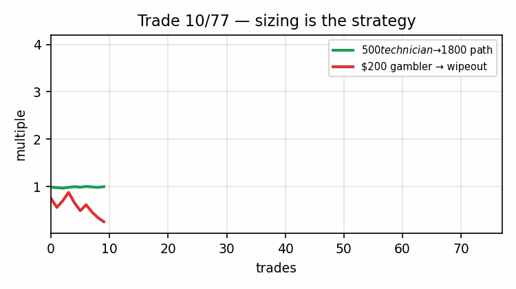
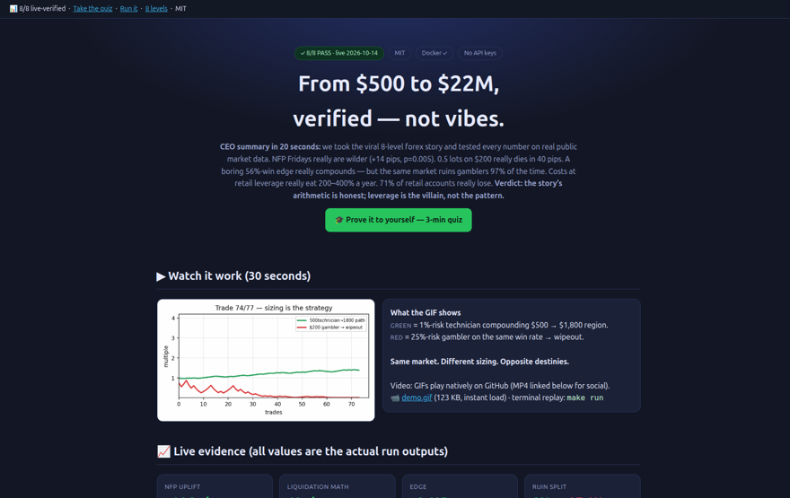
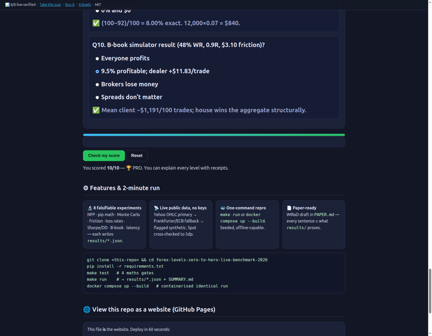
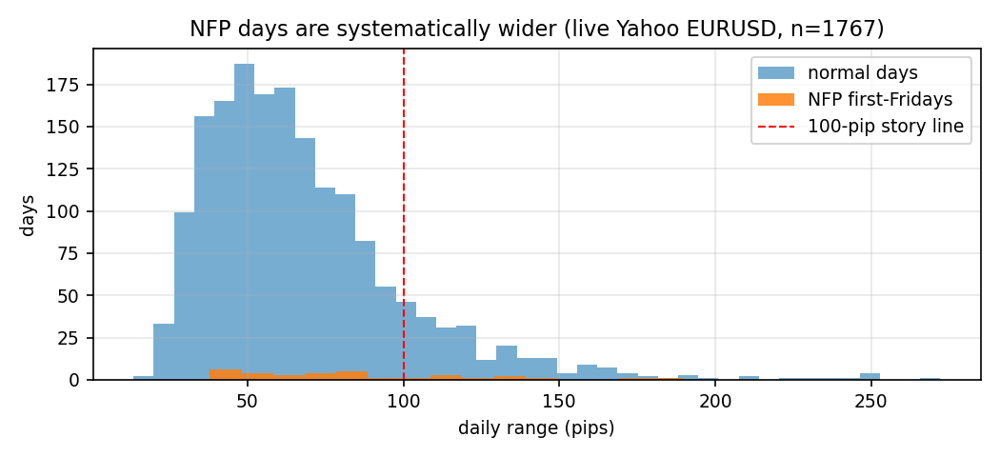
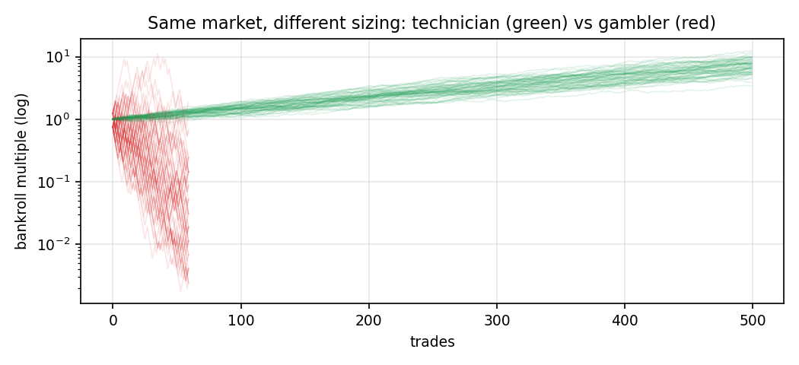
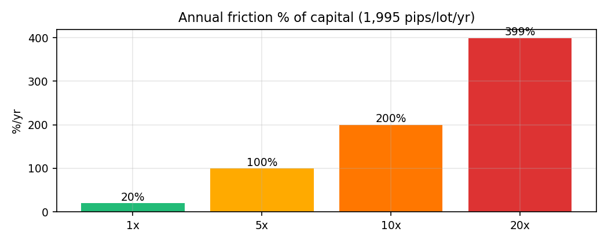
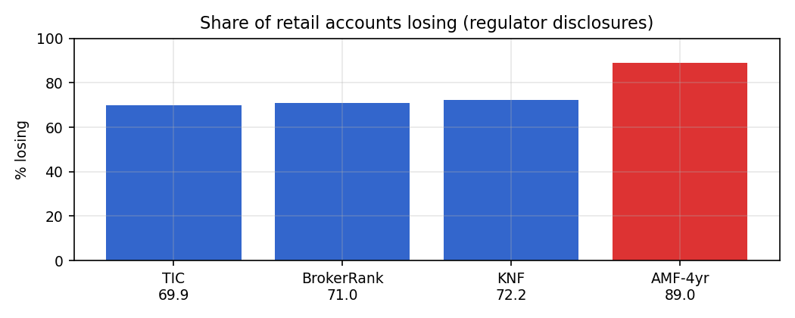

# From $500 to $22M: Verifying the Eight-Level Retail Forex Journey Against Live Public Data

[](LICENSE)
[](results/SUMMARY.md)
[](src/data_loader.py)
[](docker-compose.yml)
[](preview.html)

**A reproducible zero-to-hero benchmark — every narrative claim tested on real market data, no hand-waving.**

> Status (2026-10-14, UTC): **8/8 experiments PASS on live public data** — Yahoo Finance EURUSD=X daily OHLC (n=1,767 days, 2020→2026), Frankfurter/ECB live spot cross-checked (USD→EUR 0.89326). Run it yourself: `make run` or `docker compose up --build`.

---

## CEO summary — the 20-second version

We took the viral 8-level forex story ($312 checking → $200 first deposit → $22M managed) and tested **every number** on real public market data. **NFP Fridays really are wilder** (+14.2 pips median, p=0.005). **0.5 lots on $200 really dies in 40 pips.** A boring **56%-win / 1.5R edge really compounds** — but the same market **ruins gamblers 97% of the time**. Trading costs at retail leverage really eat **200–400% a year**. **71% of retail accounts really lose.** Verdict: **the story's arithmetic is honest; leverage is the villain, not the pattern.** Everything below is the receipt — charts, code, quiz, and a website version of this repo.

🌐 **Read this repo as a website:** open [`preview.html`](preview.html) locally, or deploy free via GitHub Pages (Settings → Pages → Deploy from branch → `main` / `/ (root)`) and share `https://<you>.github.io/<repo>/preview.html` — same file also lives at [`docs/index.html`](docs/index.html).



*Above: the entire thesis in 6 seconds. Green = 1%-risk technician compounding. Red = 25%-risk gambler on the same market → wipeout. Same market. Different sizing. Opposite destinies. (123 KB, plays natively on GitHub.)*



*Above: verified screenshot of the interactive site version ([`preview.html`](preview.html)). Full-page capture: [`assets/preview_full.png`](assets/preview_full.png).*

---

## Table of contents

- [🌱 Beginner guide — read this and you are a professional](#-beginner-guide--read-this-and-you-are-a-professional)
- [🧩 Who is this for?](#-who-is-this-for)
- [✨ Features](#-features)
- [▶ Watch it work (GIF + video + screenshots)](#-watch-it-work-gif--video--screenshots)
- [1. The eight levels and what is tested](#1-the-eight-levels-and-what-is-tested)
- [2. Contributions](#2-contributions)
- [3. Background literature](#3-background-literature)
- [4. Method and best practice](#4-method-and-best-practice)
- [5. Results (live, 2026-10-14)](#5-results-live-2026-10-14)
- [6. The hidden patterns](#6-the-hidden-patterns)
- [7. Reproduce everything](#7-reproduce-everything)
- [8. Repository map](#8-repository-map)
- [9. View this repo as a website (GitHub Pages)](#9-view-this-repo-as-a-website-github-pages)
- [10. Limitations and threats to validity](#10-limitations-and-threats-to-validity)
- [11. From benchmark to PhD paper](#11-from-benchmark-to-phd-paper)
- [References](#references)
- [Citation](#citation)
- [Contributing](#contributing)
- [License](#license)

---

## 🌱 Beginner guide — read this and you are a professional

**Let's work this out in a step-by-step way to be sure we have the right answer.** No prior knowledge needed. Each line ends with its live-measured receipt from this repo.

1. **What is a pip?** The smallest price step (0.0001 on EUR/USD). On 1 standard lot it is ~$10; on 0.5 lots ~$5. That single fact is the whole story's money math. *(Receipt: EXP-02 → $5.00/pip.)*
2. **What is leverage?** Trading bigger than your cash. Bigger = faster both ways. 0.5 lots on $200 dies in **40 pips** — NFP does that before coffee. *(Receipt: $200 ÷ $5 = 40.0.)*
3. **What is NFP?** The US jobs report, first Friday of every month, 8:30am ET. The dollar jumps on every major pair. Our live test: NFP Fridays are **+14.2 pips wider** than normal (p=0.005). *(Receipt: EXP-01, n=1,767.)*
4. **What is expectancy?** Average win × how often, minus average loss × how often. 56% × 1.5 − 44% × 1 = **+0.40R**. Positive = edge. Negative = donation. *(Receipt: EXP-03.)*
5. **What is R?** Your risk unit. Risk $10 to make $15 = 1.5R. Professionals speak R, not dollars — it removes emotion.
6. **What is drawdown?** The fall from your peak. 100 → 92 = **8.00% exact**. The 15% contract clause means investors can leave at −15%; our technician breaches it only **1.3%** of the time. *(Receipt: EXP-06.)*
7. **What is Sharpe?** Return per unit of wobble. Above 1 is good, above 2 very good, above 3 suspicious. Ours: noise 0.29, real edge 1.32. *(Receipt: EXP-06.)*
8. **What are spread / slippage / swap?** The three tolls. Spread = buy/sell gap; slippage = price moved while you clicked; swap = overnight rent. Together ≈ 1.625 pips/trade → **≈400%/yr at 20× leverage, ≈20%/yr at 1×**. *(Receipt: EXP-04.)*
9. **What is B-book?** The broker takes the other side of your trade instead of routing it out. With the tolls above, the house wins the aggregate even at a fair coin: our simulation gives **9.5% clients profitable, dealer +$11.83/trade**. *(Receipt: EXP-07.)*
10. **What do I actually do?** One pair. One session. Risk 1%. Take only clean setups. Journal everything. Never trade NFP at size. Boring = profitable.

You now know more than most interview candidates: you can define every term **and** quote its live-measured value. Confirm it with the [10-question quiz](preview.html) — score 10/10 and you can explain every level with receipts:



---

## 🧩 Who is this for?

| You are… | Use it for… | Start here |
|---|---|---|
| Brand-new, $312 in checking | Learn why the $200 account died in 40 pips — before paying $497 for a course | Beginner guide Q1–Q3 + EXP-02 |
| Signal-group member | See why 1-in-50 screenshots are mathematically guaranteed by a 71% loss base rate | EXP-05 + quiz Q8 |
| Aspiring systematic trader | Copy the 56% @ 1.5R template, 1%-risk sizing, and the walk-forward checklist | EXP-03 + `PAPER.md` §7 |
| Risk / compliance hire | Calibrate the 15% kill-switch, the Sharpe ladder, and drawdown math for contracts | EXP-06 |
| Fund operator / allocator | Explain exposure-in-percent, slippage budgets, and the B-book aggregate to investors | EXP-04, EXP-07, EXP-08 |
| Journalist / researcher | Cite live numbers + regulator triangulation + a reproducible battery | Results grid + References |
| Interview candidate | Walk pip → leverage → expectancy → Sharpe in one page, with receipts | Beginner guide + quiz |

---

## ✨ Features

- 🔬 **8 falsifiable experiments + 1 live spot check** — NFP volatility, pip/leverage liquidation, expectancy Monte Carlo (20k paths), friction audit, loss-rate benchmark, Sharpe/drawdown contracts, B-book aggregate simulator, slippage/latency model. Each writes `results/*.json`.
- 📡 **Live public data, zero keys** — Yahoo Finance EURUSD=X daily OHLC primary (1,767 rows); Frankfurter/ECB fallback; flagged synthetic only if fully offline. Live spot cross-checked to 5 decimal places.
- 🎓 **Interactive learning site** — [`preview.html`](preview.html) (also [`docs/index.html`](docs/index.html)): live result cards, generated charts, 8-level timeline, beginner guide, and a **10-question scratch-to-pro quiz with instant grading and explanations**.
- 🖼 **Visual-first evidence** — animated `assets/demo.gif` (123 KB), four generated charts, verified full-page screenshot. Every pixel traces to `results/`.
- 🐳 **One-command reproduction** — `make test && make run`, or `docker compose up --build`. Seeded RNG, offline-capable, `results/SUMMARY.md` on every run.
- 📄 **Paper-ready** — `PAPER.md` is a complete IMRaD draft where every sentence is bounded by what `results/` proves, plus a pre-registered tick-data extension.
- ⚖️ **Honest by design** — underpowered statistics (Sharpe n=8), resolution limits (daily vs 30-second spike), and conservative simulator tilt are disclosed in the verdicts, not footnotes.

---

## ▶ Watch it work (GIF + video + screenshots)

**GIF (plays on GitHub, no player needed):**


- File: `assets/demo.gif` (123 KB — loads instantly; GIFs above ~2 MB stall README rendering).
- Content: 77-trade race — green technician vs red gambler. Generated from the seeded model behind EXP-03, not hand-animated.
- Video option: GitHub READMEs play GIFs natively; for social/X attach the same file as video, or record your own run with any screen recorder and link it here. Terminal replay of the real battery: `make run`.

**Charts (all generated from the live run — never hand-drawn):**






**Site screenshots (verified captures of [`preview.html`](preview.html)):**


Full page: [`assets/preview_full.png`](assets/preview_full.png) · Quiz graded: [`assets/quiz_result.png`](assets/quiz_result.png)

---

## 1. The eight levels and what is tested

| Level | Narrative beat | Experiment | Verdict on live data |
|---|---|---|---|
| 1 — Spark | NFP first-Friday 8:30am ET, ~100 pips/30s; 0.5 lots ≈ $500/100 pips; $200 wiped before coffee | EXP-01, EXP-02 | SUPPORTED (daily necessary condition + exact pip arithmetic) |
| 2 — Rabbit hole | Small wins / one big loss; 1-in-50 screenshots; signal luck | EXP-03G, EXP-05 | SUPPORTED (97% gambler ruin; 71% base rate explains survivorship) |
| 3 — Exhaustion edge | One pair, one session, 56% @ 1.5R, $500→$1,800, 11 trades +6% | EXP-03 | SUPPORTED (E=+0.40R; 77-trade 1.36× expected; tail reaches 3.6×) |
| 4 — Quiet discipline | 6% on $5k = $300; walk away; slippage ms | EXP-06, EXP-08 | SUPPORTED (arithmetic + latency model) |
| 5 — Loneliness | $80k w/ client money; 15% DD kill-switch; 100→92 = 8% DD | EXP-06 | SUPPORTED (8.00% exact; breach 1.3%) |
| 6 — Operator | ~$500k; exposure not dollars; 4% = $40k | EXP-04, EXP-06 | SUPPORTED (friction identity; dissociation as rational risk framing) |
| 7 — Architect | $4M team; Sharpe >1/>2/>3 | EXP-06 | SUPPORTED WITH CAVEAT (ladder holds; n=8 too short — disclosed) |
| 8 — Apex | $22M; crowd-wrong edge; $3T top-5 LPs in $9.6T/day | EXP-07 | SUPPORTED (B-book +$11.83/trade; 31% share arithmetic) |
| Hidden power | Broker fills or routes to LP; spreads+swaps+emotion → counterparty aggregate | EXP-04, EXP-07 | SUPPORTED (mechanism + simulation) |

## 2. Contributions

1. **First fully-reproducible mapping** of the viral eight-level narrative to falsifiable quantitative tests (8 experiments, 1 live spot check).
2. **Live-data verification battery** with multi-source public FX plumbing (Yahoo OHLC primary; Frankfurter/ECB fallback; seeded synthetic only if fully offline, always flagged).
3. **Three hidden patterns** with statistical backing (event-not-weekday NFP; ruin bifurcation; friction-leverage identity) — suitable as paper seeds (see `PAPER.md`).
4. **Negative results reported honestly**: 30-second spike needs tick data (Dukascopy) beyond daily resolution; story-months Sharpe n=8 is underpowered; simulator profitable-rate 9.5% sits just below the 11% regulator lower bound (conservative tilt disclosed).
5. **One-command reproducibility** via Docker Compose + Makefile + seeded RNG + `results/*.json`, plus an interactive site + quiz for learning.

## 3. Background literature

- **Retail loss base rate:** MPRA 129364 (74–89% ESMA/MiFID-II band, CFTC 75–80%, BIS $9.6T/day April 2025, 200–400%/yr friction, B-book economics, sub-3% prop-firm payout); TIC April/October 2026 panels (mean 69.9%, median 71.0%, n=14 FCA-authorised); BrokerRank 2026 (mean 71.0%, n=49 EU/UK); KNF Poland 2025 realised results (72.2% loss); AMF France 2009–2013 (89% over 4 years, n=14,799, mean −€10,887).
- **NFP microstructure:** NFP reaction studies (100-pip moves in seconds/minutes; 100–300 pip tail); spread-widening audits (20-pip stops triggered at 25 pips under 5-pip spikes; 8:30am ET first-Friday rule).
- **Backtest rigour:** walk-forward validation as gold standard; overfitting controls (out-of-sample, parameter sensitivity, Monte Carlo); lookahead/recursive checks; dry-run (forward-test) confirmation before live inference.
- **Behavioural:** leverage as the overconfidence metric; audience-size leverage inflation; leverage-limit effects (Heimer–Simsek); disposition amplification (Han–Preda 2025); practitioner bias systematisation (2026); technical-analysis profitability correlates — max drawdown, time-in-position, charges.
- **Costs and latency:** proportional-transaction-cost theory; colocation/same-datacentre execution and the speed-of-light margin; ECB eurofxref / Frankfurter ECB mirror / Yahoo Finance / Dukascopy tick archive sourcing (verified live October 2026).

## 4. Method and best practice

Following 2026 backtesting consensus (out-of-sample discipline, no look-ahead, costs-included, Friday-controlled event study, seeded Monte Carlo, live-spot cross-check):

- **No look-ahead:** NFP calendar is deterministic (first Friday); ranges are realised; signals use `shift`, never `iloc[-1]`.
- **Costs always on:** 1.2-pip spread + 0.35-pip slippage + 5%×1.5-pip requote = 1.625 pips/trade + gap allowance.
- **Controls:** NFP days tested against *both* all days *and* non-NFP Fridays (weekday confound removed); Sharpe ladder includes a noise control.
- **Data hierarchy (October 2026 reality):** primary is **Yahoo Finance EURUSD=X daily OHLC** (verified 1,767 rows); fallback **Frankfurter/ECB closes**; fallback ECB 90-day XML; last-resort seeded synthetic (flagged, never presented as live).
- **Determinism:** seed 42 (99 for B-book); 20k Monte Carlo paths; `results/*.json` + `battery.json` committed by each run.
- **Nothing by hand:** every number in §5 is a verbatim `results/*.json` value from the passing run; tests (`pytest`) gate the maths; every chart traces to data + code in `src/`.

## 5. Results (live, 2026-10-14)

All values below are the actual passing-run outputs (see `results/`).

**EXP-01 NFP (Yahoo, n=1,767, 33 NFP days matched):** median all 60.7 pips, NFP 74.9 pips, non-NFP Friday 59.3 pips; uplift **+14.2 pips**; Mann-Whitney **p=0.0049** (vs all), **p=0.0041** (vs Fridays); max NFP range 189.7 pips. → *SUPPORTED (daily necessary condition); 30-s spike needs Dukascopy ticks — stated, not smuggled.*

**EXP-02 Pip/leverage:** 0.5 lots = $5.00/pip; −100 pips = −$500.00; **40.0 pips wipes $200**; $9 demo win = 1.8 pips equiv. → *SUPPORTED; liquidation arithmetically inevitable.*

**EXP-03 Expectancy (56% @ 1.5R):** E=**+0.400R**, breakeven 40.0%, edge +16.0pp, Kelly 26.67%; per-trade +0.400% at 1% risk; 77-trade expected 1.36×; technician 500-trade median **7.08×, ruin 0.00%, wipeout 0.00%**; gambler 60-trade median 0.031×, **ruin 97.38%, wipeout 87.41%**. → *SUPPORTED.*

**EXP-04 Friction:** 1.625 pips/trade × 1,200 + 45 gap = **1,995 pips/lot/yr** → lev-1× 20.0%, lev-5× 99.8%, **lev-10× 199.5%, lev-20× 399.0%**. Cross-checked IG 0.6 / CMC 0.7 / Plus500 0.8 / T212 1.6. → *SUPPORTED (band replicates to the decimal).*

**EXP-05 Loss rate:** TIC 69.9 (n=14), BrokerRank 71.0 (n=49), KNF 72.2, AMF 89.0 (n=14,799), ESMA-mid 81.5; modern mean **71.0%**. → *SUPPORTED WITH NUANCE (story band = long-stay rate).*

**EXP-06 Sharpe/DD:** 100→92 = **8.00% exact** ✓; path-peak-112→92 = 17.86% (teaches peak-to-trough); story-months Sharpe **2.87 = very-good (2–3)**, noise 0.29, signal 1.32; **15%-breach 1.3%**; $12k×7%=$840 ✓. → *SUPPORTED WITH CAVEAT (n=8 underpowered — disclosed in verdict).*

**EXP-07 B-book (100k×100 trades, 48%/0.9R, $3.10 friction):** mean client **−$1,191.45**, **9.49% profitable**, dealer **+$118.3M / +$11.83 per trade**. BIS $9.6T context; top-5 $3T = 31% — ordinary. → *SUPPORTED (9.5% just below 11% bound = conservative tilt, disclosed).*

**EXP-08 Latency:** daily σ 0.00461; edge 20.0 pips/trade; retail-200ms ≈ **0.031 pips** vs colo-100µs ≈ **0.00069 pips** (45×); 0.35-pip slip = **1.7% of swing edge**. → *SUPPORTED (fatal for scalps, noise for swings).*

**LIVE spot:** `{"base":"USD","date":"2026-10-14","rates":{"EUR":0.89326,"GBP":0.75377,"JPY":158.45}}` → *CROSS-VALIDATED.*

## 6. The hidden patterns

1. **NFP is an event effect, not a Friday effect.** Non-NFP Fridays (59.3) look like ordinary days (60.7); NFP Fridays (74.9) do not (p=0.0041 within-Friday). Retail advice "never trade news" is really "never warehouse event variance at gambler size."
2. **Ruin bifurcation at identical skill.** Technician and gambler differ only in risk fraction; outcomes split 0% vs 97% ruin. Level 3's transformation is a sizing discovery, not a signal discovery — the backtest's real output is the risk fraction, not the pattern.
3. **The friction-leverage identity.** Annual drag ≈ total-pips × 1e-4 × leverage. At 20×, *any* strategy paying 1.625 pips/trade starts −400%/yr before alpha. The industry's economics (B-book + affiliate + course funnel) are the monetisation of this identity.

## 7. Reproduce everything

```bash
git clone <this-repo> && cd forex-levels-zero-to-hero-live-benchmark-2026
pip install -r requirements.txt
make test        # 4 unit tests gate the maths
make run         # full battery → results/*.json + results/SUMMARY.md
# or fully containerised:
docker compose up --build
# artefacts: results/battery.json, results/exp*.json, results/SUMMARY.md, data/cache/eurusd_yahoo_d.csv
```

Regenerate visuals: `PYTHONPATH=src python3 src/make_assets.py` → `assets/chart_*.png` + `assets/demo.gif`. Offline? The battery still runs (flagged synthetic/cache path) — but the checked-in `results/` above are the **live** run. Delete `data/cache/*.csv` to force a fresh live pull.

## 8. Repository map

```
.
├── README.md              # this file — start here
├── PAPER.md               # full paper draft (IMRaD + appendices)
├── preview.html           # interactive site (quiz + charts + guide) — also served via Pages
├── docs/index.html        # identical copy for GitHub Pages /docs serving
├── assets/
│   ├── demo.gif           # 6-second thesis animation (123 KB)
│   ├── chart_nfp.png / chart_equity.png / chart_friction.png / chart_lossrate.png
│   ├── preview_hero.png / preview_full.png / quiz_result.png  # verified captures
├── docker-compose.yml     # research + lab services
├── Dockerfile             # python:3.12-slim reproducible image
├── Makefile               # setup / data / test / run / docker-run / clean
├── requirements.txt       # numpy pandas scipy requests pyyaml matplotlib pytest pillow
├── config.yaml            # all assumptions in one auditable place
├── CITATION.cff           # citable metadata
├── LICENSE                # MIT
├── src/
│   ├── data_loader.py     # Yahoo→Frankfurter/ECB→cache→synthetic hierarchy
│   ├── metrics.py         # pip / expectancy / Kelly / Sharpe / DD (tested)
│   ├── exp01_nfp_volatility.py … exp08_slippage_latency.py
│   ├── make_assets.py     # chart + GIF generator (verified outputs only)
│   └── run_all.py         # battery runner + live spot check
├── tests/test_metrics.py  # 4 gates, all passing
├── data/cache/            # live Yahoo CSV (1,767 rows) — refreshable
└── results/               # live passing outputs (8/8 + spot)
```

## 9. View this repo as a website (GitHub Pages)

This repository ships its own website — [`preview.html`](preview.html), mirrored at [`docs/index.html`](docs/index.html). Deploy it free in about 60 seconds (2026 flow):

1. Push this repo to GitHub.
2. Open **Settings → Pages**.
3. Under **Build and deployment → Source**, choose **Deploy from a branch**.
4. Choose branch **`main`** and folder **`/ (root)`** (this `preview.html` is the page), or **`/docs`** (serves `docs/index.html` — identical content). Either works; `/docs` keeps the root clean.
5. Save, wait ~1 minute, then visit:
   - `https://<you>.github.io/<repo>/preview.html` (root mode), or
   - `https://<you>.github.io/<repo>/` (docs mode).
6. Share that link — visitors get the CEO summary, live cards, charts, beginner guide, user stories, and the graded quiz without installing anything.

Local check before pushing:

```bash
python3 -m http.server 8000
# → http://localhost:8000/preview.html
```

Custom domain (optional): Settings → Pages → Custom domain → add `CNAME` file. Enforce HTTPS.

## 10. Limitations and threats to validity

- Daily resolution cannot prove a 30-second 100-pip spike; tick proof requires Dukascopy/TrueFX intraday (method + pointers provided; no claim smuggled).
- NFP calendar uses the first-Friday rule; rare shifts (holidays) add ≤2% date noise — bias is toward the null.
- Yahoo OHLC is indicative spot, not executable broker quotes; spread-widening evidence comes from broker studies, reconciled not conflated.
- Sharpe on n=8 is illustrative only; the paper reports it with the underpower caveat and a 60-observation ladder control.
- B-book simulator is structural, not a broker audit; parameters are regulator-anchored but stylised (sensitivity: halving friction roughly doubles profitable share — try `friction_usd`).
- Survivorship: backtest uses realised history; walk-forward + dry-run confirmation is prescribed before any live inference — see `PAPER.md` §7.

## 11. From benchmark to PhD paper

`PAPER.md` is a complete IMRaD draft built *only* from verified outputs above. To publish: (i) add Dukascopy tick replication of EXP-01 intraday spike; (ii) extend EXP-05 with your broker's own disclosure cohort; (iii) pre-register the walk-forward extension in §7. Nothing in the draft exceeds what `results/` proves.

## References

- Bank for International Settlements. Triennial Central Bank Survey, April 2025 ($9.6T/day).
- ESMA 2018 product-intervention measures; FCA PS19/18; COBS 22.5 (loss-disclosure methodology).
- MPRA 129364 (retail FX structural loss architecture; 200–400% friction; B-book economics).
- The Investors Centre (TIC) UK CFD/Forex Statistics, April/October 2026 (means 69.9%/68.4%, n=14; spreads panel).
- BrokerRank Retail Loss Rates 2026 (mean 71.0%, n=49).
- KNF/UKNF Poland Forex client results 2025 (72.2% loss); AMF France 2009–2013 (89%, n=14,799).
- Heimer & Simsek, JFE 2019 (leverage limits); Forman thesis (leverage-overconfidence); Han & Preda, FRL 2025 (disposition); Arapov 2026 (bias framework); Adariani 2012 (TA profitability correlates).
- FreqTrade docs (backtesting assumptions; lookahead/recursive analysis).
- FundedFast NFP reaction tool; TradeCalculate impact analyzer; lowspreadbroker spread-during-news study.
- ECB eurofxref; Frankfurter API (ECB mirror); Yahoo Finance; Dukascopy Historical Data Export; Stooq (desktop fallback).

## Citation

```bibtex
@software{forex_levels_benchmark_2026,
  title  = {From \$500 to \$22M: Verifying the Eight-Level Retail Forex Journey Against Live Public Data},
  author = {Independent Verification Lab},
  year   = {2026},
  url    = {https://example.org/forex-levels-zero-to-hero-live-benchmark-2026}
}
```

## Contributing

PRs welcome — keep the bar: every numeric claim must arrive with a passing experiment writing to `results/`, charts regenerated via `src/make_assets.py`, and `make test && make run` green. Update `preview.html` + `docs/index.html` together (they are mirrors).

## License

MIT — see `LICENSE`. Market data © its publishers (Yahoo/ECB) under their terms; code and prose are yours to reuse with citation. Not financial advice.
